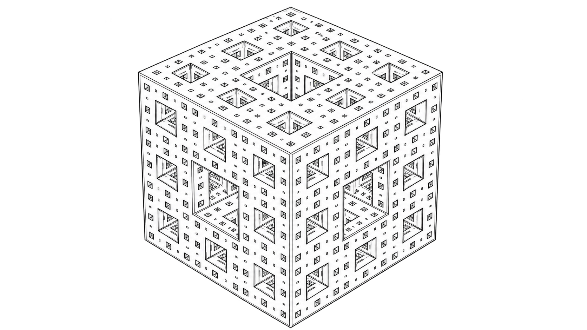
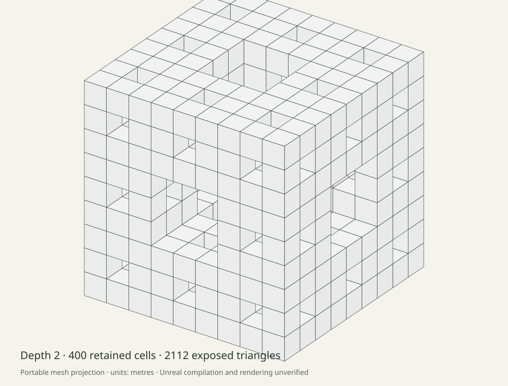

# Fractal FPV



*Generated line-art concept illustration.*

A bounded fractal generator and virtual FPV camera study, with one C++ core shared by portable tools and an Unreal project. The local browser explorer renders the actual exported meshes and replays a camera track produced by that core.

The portable build and browser preview are available. **Unreal compilation, editor startup, rendering, game packaging, input acceptance and engine profiling remain unverified.** No Unreal Engine is installed on this Mac, and no engine or paid assets were downloaded.

## Open the browser preview

Use Python 3.11+ from this repository:

```sh
python3 scripts/preview.py
```

Open **http://127.0.0.1:8796/** in a browser with WebGL 2. Select detail levels 0–2, switch surface/wireframe, orbit with a pointer or keyboard/buttons, zoom, and play or scrub the recorded track. No compiler or Unreal installation is needed to inspect the committed browser fixtures. All assets are local; there are no CDN scripts, analytics, accounts or remote model calls.

The camera is kinematic and **collision is disabled**. It can pass through solid regions. The 721 recorded poses are sampled at 60 Hz; this is not a renderer frame-rate measurement. At the end, the camera has moved beyond the mesh; reset orbit to inspect it again.

## Build and generate

On a system with clang++ or g++ and Python 3.11+:

```sh
python3 scripts/build_portable.py
python3 scripts/fractal.py mesh --depth 2 --size-m 20 --out runs
python3 scripts/fractal.py track --out track-run
python3 -m unittest discover -s tests -v
node --test tests/view-model.test.mjs
python3 scripts/reproduce.py
```

Output directories must be new and their parent must exist. Mesh export writes `mesh.json`, `mesh.obj`, and `report.json`; track export writes `camera-track.json`. The wrapper checks the compiled binary's source fingerprints before use and refuses stale binaries. No Unreal process is invoked.

Alternatively use CMake 3.20+ with a C++17 toolchain, including MSVC on Windows:

```sh
cmake -S . -B build -DCMAKE_BUILD_TYPE=Release
cmake --build build --config Release
ctest --test-dir build -C Release --output-on-failure
python scripts/fractal.py mesh --depth 2 --size-m 20 --out runs
```

The direct clang route ran locally. CMake/CTest is checked separately in CI. Node 22+ is needed only for browser-model development tests. Runtime tools have no third-party library dependency.

## Actual geometry results



At a 20 m side length, the [recorded core reports](docs/results/metrics.json) contain:

| Depth | Retained cells | Exposed faces | Surface triangles | Unculled-cube baseline |
| --- | ---: | ---: | ---: | ---: |
| 0 | 1 | 6 | 12 | 12 |
| 1 | 20 | 72 | 144 | 240 |
| 2 | 400 | 1,056 | 2,112 | 4,800 |
| 3 | 8,000 | 18,048 | 36,096 | 96,000 |

Depth 2 removes **56% of baseline triangles** by omitting internal faces. That is a count comparison, not a measured speed gain. Units are metres, square metres and cubic metres. Depth is capped at 3; this is a finite construction, not an infinite world. The mesh is not certified as a manifold fabrication model.

The [camera summary](docs/results/camera-summary.json) records a 60 m straight path over 12 seconds, from `[-30,0,0]` to `[30,0,0]`, using the core at 5 m/s. See [OBJ example](docs/results/depth-1.obj), [actual mesh JSON](web/assets/mesh-2.json), and [recorded camera poses](web/assets/camera-track.json).

`python3 scripts/reproduce.py` regenerates **nine artifacts byte-for-byte** through the actual tools, including meshes, reports, camera data, an orthographic projection and source/output hashes. Use `--write` only to refresh reviewed outputs. Exported decimals are rounded to six places; full-precision geometry tests are separate.

## Unreal project source

The repository includes `FractalFPV.uproject`, module/targets, a ProceduralMeshComponent actor, FPV pawn, HUD, game mode, input configuration and default Entry-map startup. Startup source spawns the shared-core mesh, an outside camera, dynamic lights and a built-in surface material. No binary engine assets are redistributed.

On an existing licensed Unreal installation, select the engine for the project, generate project files, build the `FractalFPVEditor` target, then open the project and press Play. The source targets the UE 5.4 API family; each actual engine version still needs acceptance checks. Entry is an engine map: use Save As into your own Content folder before editing a map. See the [engine validation checklist](docs/unreal-validation.md).

Controls in the Unreal source: **WASD** movement, **Space / left Ctrl** world vertical, **mouse or arrows** look, and **R** reset. Actor scale is 1; core metres are converted to engine centimetres by multiplying positions by 100. The camera has no collision, acceleration, drone physics or hardware control.

The [methods](docs/methods.md) explain mesh winding, native box alignment, the browser's left-handed projection, units, limits and numerical checks. Read [the contract](docs/contract.md), [contributing](CONTRIBUTING.md), and [security](SECURITY.md).

## History and artwork

Implemented in October 2026 in the renamed `SaaS-Template-MagicUI` repository. Its original main revision `bef9ee9fd48f64606bede1724b66fe08e53f670a` remains at `archive/before-fractal-fpv-2026-10-27`. The original README attributes Magic UI and the original ZIPs remain in the archive. No old code, assets or styles are reused. MIT applies only to the new source; repository age and stars do not describe this implementation date.

The user-approved cover is concept art with [portable provenance](docs/images/cover-provenance.json). It is not an engine screenshot. The projection figure is actual portable program output. MyPortfolio is unchanged.
